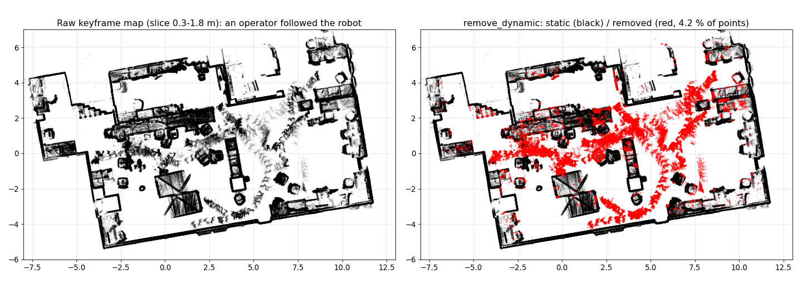
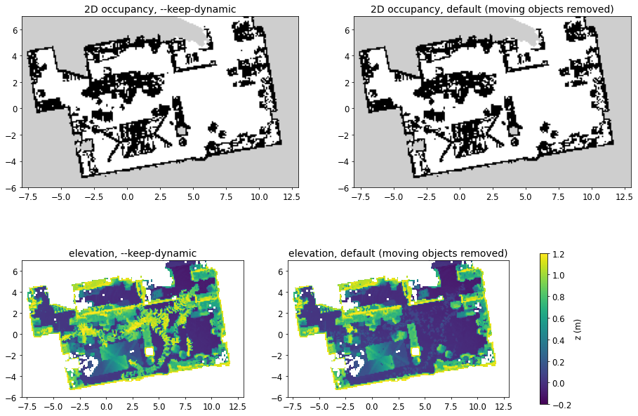
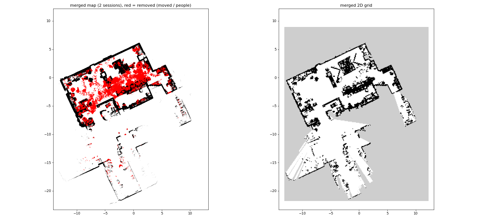

# lidar_map_cleaner

**Remove people and other moving objects from 3D LiDAR SLAM maps, online and offline, and build clean
2D occupancy / OctoMap / elevation layers for navigation.** ROS 2 (Jazzy), pure Python + NumPy/SciPy, works
next to any LiDAR(-inertial) odometry or SLAM (FAST-LIO, LIO-SAM, KISS-ICP, ...).


*An operator walked behind the robot during mapping. `remove_dynamic` removes the trace (red) and keeps walls and furniture.*


*`build_layers` regenerates the navigation layers from the keyframes. Left: people kept; right: default. The person's trace
disappears from the elevation map, and the layers use the final, loop-closed keyframe poses.*

## What's inside

| Tool | Type | What it does |
|---|---|---|
| `dynamic_filter` | ROS 2 node (online) | Removes points that **appeared in previously free space** from each incoming scan. Feed its output to your mapping back-end (OctoMap, PGO, ...). ~7–14 ms per VLP-16 scan on a laptop CPU. |
| `remove_dynamic` | CLI (offline) | Removes moving objects from a saved keyframe map with a visibility ("seen-through") test over all keyframes. |
| `build_layers` | CLI (offline) | Rebuilds `octomap.bt`, a Nav2 `grid.pgm/yaml`, an elevation map (+ colour `elevation.png`) and height-coloured voxels (`voxels.pcd`, optional `voxels.ply` cube mesh) from the keyframes, **without** moving objects and **at loop-closed poses**. |
| `clean_floor` | CLI (offline) | Final touch for `map.pcd`: removes floor-level leftovers (caster wheels, shoe soles) and small isolated clusters; keeps the recorded floor surface (`--flatten` for an even floor). |
| `merge_maps` | CLI (offline) | Merges two mapping sessions of the same place: global 2D alignment (no initial guess) + point-to-plane ICP, optional floor levelling. |
| `elevation_mapper` | ROS 2 node | 2.5D elevation map (`grid_map_msgs/GridMap`). In `octomap` mode the floor is accumulated and obstacles come from OctoMap's ray-cleared voxels, so moving-object traces disappear online. |

## Install

```bash
sudo apt install ros-jazzy-octomap-server ros-jazzy-grid-map-msgs python3-scipy
cd ~/ros2_ws/src && git clone https://github.com/lkh0320/lidar_map_cleaner.git
cd ~/ros2_ws && colcon build --packages-select lidar_map_cleaner && source install/setup.bash
```

## Quick start

### Online: filter scans before they reach your map

Needs a **body-frame** cloud and the odometry of the same frame with matching stamps
(FAST-LIO: `/fastlio2/body_cloud` + `/fastlio2/lio_odom`, or `/cloud_registered_body` + `/Odometry`).

```bash
ros2 launch lidar_map_cleaner dynamic_filter.launch.py cloud:=/fastlio2/body_cloud odom:=/fastlio2/lio_odom
# -> /cloud_static  (use this for octomap_server, your PGO, ...)
# -> /cloud_dynamic (removed points, for RViz)
```

Set your sensor in `config/dynamic_filter.yaml` (copy it and pass `params:=<file>`):
`sensor.preset` (`vlp16`, `os1_64`, `os1_128`, `hesai_xt32`, ...) and `sensor.xyz` / `sensor.rpy` = LiDAR pose in the
body frame. Use a ground-level body frame (e.g. `base_footprint`): only points between `min_height` and
`max_height` above it are judged, so the floor and ceiling are never removed.

### Offline: clean a saved map

```bash
ros2 run lidar_map_cleaner remove_dynamic <map_dir> --sensor-xyz 0.125,0,0.368            # map_static.pcd + map_dynamic.pcd
ros2 run lidar_map_cleaner remove_dynamic <map_dir> --sensor-xyz 0.125,0,0.368 --replace  # map.pcd <- static (map_raw.pcd kept)
ros2 run lidar_map_cleaner build_layers   <map_dir> --sensor-xyz 0.125,0,0.368            # octomap.bt, grid.pgm/yaml, elevation.*, voxels.pcd
```

Merge two sessions (e.g. two bags recorded on different days), then clean the result:

```bash
ros2 run lidar_map_cleaner merge_maps <map_A> <map_B> <merged_dir>        # B is aligned onto A, floor levelled
ros2 run lidar_map_cleaner remove_dynamic <merged_dir> --sensor-xyz 0.125,0,0.368 --replace
ros2 run lidar_map_cleaner build_layers   <merged_dir> --sensor-xyz 0.125,0,0.368
```

If one session is the "clean" one (e.g. you tidied chairs away before recording it), make it the reference with
`--prefer a_` on both commands: its points are judged only by its own keyframes, points of the other session are removed
where the reference saw free space, and kept where the reference never looked (they fill its gaps).

Optional final touch for the point-cloud map (keeps `map_before_floor.pcd`):

```bash
ros2 run lidar_map_cleaner clean_floor <map_dir>             # floor surface kept as recorded
ros2 run lidar_map_cleaner clean_floor <map_dir> --flatten   # even floor (also removes LiDAR ring patterns)
```

The floor surface (< 2.5 cm above the local floor) is kept as recorded; the thin band 2.5–5 cm above it, where caster
wheels and shoe soles remain, is emptied; then 5 cm voxel clusters of at most 20 voxels below 0.5 m are removed.
`--flatten` replaces everything below 5 cm by one point per 5 cm cell instead. Objects lower than 5 cm (cables, door
thresholds) lose their top or merge into the floor.

`build_layers` outputs: `elevation.png` (turbo colormap, blue = low, red = high, transparent = no data) next to
`elevation.npz/pgm/yaml`, and `voxels.pcd` — the static map as 10 cm voxel centres coloured by height above the floor
(`pcl_viewer -ps 6 voxels.pcd`, RViz or CloudCompare). `--voxel-ply` also writes `voxels.ply`, the same voxels as
coloured cubes (MeshLab / CloudCompare / Blender). `--voxel-size` and `--voxel-color-max` (height shown red) adjust them.

`build_layers` starts its own `octomap_server` in a private ROS domain (localhost), so it can run on a robot while the
robot stack is up.

### Map directory format

```
<map_dir>/poses.txt        <patch file> x y z qw qx qy qz      # body pose in the map frame, one line per keyframe
<map_dir>/patches/*.pcd    keyframe clouds in the body frame (binary PCD, x y z [intensity])
```

This is what [FASTLIO2_ROS2](https://github.com/liangheming/FASTLIO2_ROS2)'s PGO writes with
`ros2 service call /pgo/save_maps interface/srv/SaveMaps "{file_path: '<dir>', save_patches: true}"`.
From any other SLAM, dump the keyframes (body-frame clouds + optimised poses) in this layout.

## How it works

**Online (`dynamic_filter`).** The last few seconds of scans are kept as range images
(elevation bins × azimuth bins, closest return per pixel). Each point of a new scan is projected into them; if earlier
beams travelled clearly *beyond* it, the space was empty and the point belongs to something that moved in. Votes from
several past scans, an azimuth-eroded image (no hits on object edges), a voxel cluster check and a short track
(a person who stops for a moment is still removed) make the decision. **Static protection:** voxels observed in
many scans over several seconds are never removed. Sparse clutter (chair legs, shelves) lets some beams through from
some viewpoints; without this protection it was flagged as dynamic (precision 61 % → 92 % on our data).

**Offline (`remove_dynamic`).** Every map voxel is tested against every keyframe's range image: if beams passed
through it more often than they hit it, it is dynamic. Only the band between floor + 0.15 m and floor + 2.2 m is
judged (floor = height of the nearest keyframe), because grazing floor/ceiling returns produce false see-throughs.
The near-floor band (4–15 cm), which this test cannot judge, is handled separately: low points of a cell whose upper
part was removed entirely go too (feet, bottoms of moved objects), and with `--prefer` low points of the other session
are removed where the reference saw only floor (e.g. chair bases that were moved). The floor height there is estimated
per cell from the points.

**Layers (`build_layers`, `elevation_mapper`).** Static keyframe points are re-inserted into `octomap_server`
from the LiDAR origin at their final poses; the 2D grid is OctoMap's projection. The offline elevation map is computed
from the static points: a cell is an obstacle (highest point) only if at least max(3, 10 %) of its points are more than
6 cm above the local floor; otherwise its height is the median of its floor points. Taking the highest point everywhere
makes a flat floor blotchy, because a few noisy returns or ring-pattern points 4–8 cm high are enough to lift a cell
(on our map: floor cells more than 3 cm above their surroundings 19 % → 10 %). Online, OctoMap alone erases
the floor (grazing beams clear floor voxels — more than half of the floor cells vanished in our tests), so the floor is
accumulated from points and only obstacles come from OctoMap.

**Merging (`merge_maps`).** Wall slices of both maps become 2D occupancy images; B is rotated in 1° steps and the best
translation per angle comes from FFT cross-correlation, so no initial guess is needed. The best candidate seeds a
6-DoF point-to-plane ICP. If a session started with a wrong gravity estimate, the whole map is tilted; a plane through
all (ground-level) keyframe positions is levelled to z = 0. On the merged map, `remove_dynamic` also removes objects
that **moved between sessions** (chairs, doors), which is usually what you want for a localization map.
With `--prefer <prefix>` one session is authoritative and the other only fills the places it did not observe.

## Results (honest numbers)

Developed and evaluated on **one robot**: 4-wheel skid-steer, Velodyne VLP-16 + 9-axis IMU, FAST-LIO2 + PGO, indoor
lab/office, an operator walking around the robot. No public benchmark yet (see Roadmap).

| | |
|---|---|
| `remove_dynamic` | 4.2 % of map points removed (the operator's trace), walls/furniture kept (figure above) |
| `dynamic_filter` vs. offline labels | precision ~92 %, recall ~35 % per point; 2D occupied cells unchanged (5839 → 5848) |
| `dynamic_filter` runtime | 7–14 ms per scan (Python, single core, laptop CPU; scans every 100 ms) |
| moving-object points left in the live PGO map | 110 k → 70 k with the filter on (the rest is removed offline) |
| `merge_maps` (two sessions, 13 h apart, ~160 s + 264 s) | 98 % of B's wall points overlap A, point-to-plane median 1.9 cm / 90 % 8.2 cm; a 1.9° start-up tilt of one session levelled |


*Live PGO map without (left) and with (right) `dynamic_filter`. Red: points the offline pass still had to remove.*

Recall of the online filter is limited by design: it removes things that **enter previously observed free space**.
People who were there from the start, or who walk right next to the robot where no earlier beam looked, are left for
the offline pass.


*Two sessions merged and cleaned. Red: removed (people and objects moved between the sessions).*

Synthetic tests (ray-cast box room, VLP-16 model, walking person, two sessions with a known transform and tilt): `python3 -m pytest test/ -q`.

## Limitations

- Only tested with a VLP-16 indoors. Other presets are datasheet beam layouts, not field-tested.
  Non-uniform beam layouts (e.g. VLP-32C) are approximated by uniform bins.
- Height-band logic assumes a ground robot with a ground-level body frame. For handheld / aerial data, set
  `min_height` / `max_height` (online) or `--floor-margin` / `--max-height` (offline) accordingly.
- Layers built online are not re-aligned after loop closures (true for `octomap_server` in general); use `build_layers`.
- Python: fast enough for 16–32 beam sensors at 10 Hz; 128-beam sensors are untested.

## Roadmap

- Quantitative results on a public benchmark (e.g. the [DynamicMap benchmark](https://github.com/KTH-RPL/DynamicMap_Benchmark))
- Ready-made exporters for LIO-SAM / KISS-ICP keyframes
- C++ implementation of the online filter

## Related work

The core ideas are well known; this package packages them for ROS 2 navigation maps and adds the static protection and
floor/obstacle split described above.
[Removert](https://github.com/gisbi-kim/removert) (Kim & Kim, IROS 2020),
[ERASOR](https://github.com/LimHyungTae/ERASOR) (Lim et al., RA-L 2021),
[Dynablox](https://arxiv.org/abs/2304.10049) (Schmid et al., RA-L 2023),
[M-detector](https://www.nature.com/articles/s41467-023-44554-8) (Wu et al., Nat. Commun. 2024),
[DUFOMap](https://arxiv.org/abs/2403.01449) (Duberg et al., RA-L 2024),
[elevation_mapping_cupy](https://arxiv.org/abs/2204.12876) (Miki et al., IROS 2022).

## License

MIT
