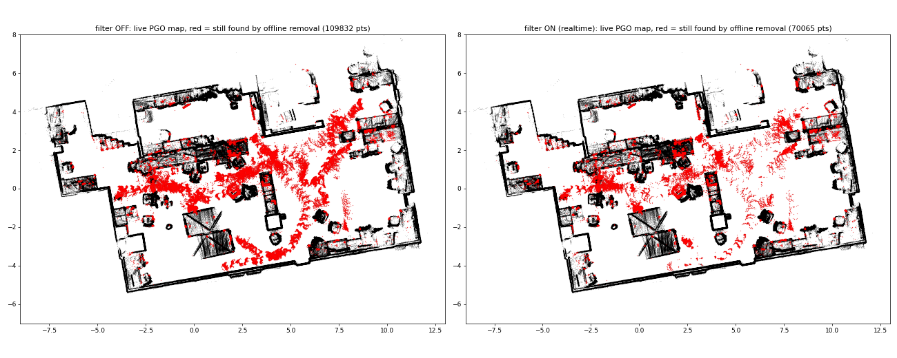

# lidar_map_cleaner

**Remove people and other moving objects from 3D LiDAR SLAM maps, online and offline, and build clean
2D occupancy / OctoMap / elevation layers for navigation.** ROS 2 (Jazzy), pure Python + NumPy/SciPy, works
next to any LiDAR(-inertial) odometry or SLAM (FAST-LIO, LIO-SAM, KISS-ICP, ...).


*An operator walked behind the robot during mapping. `remove_dynamic` removes the trace (red) and keeps walls and furniture.*


*`build_layers` regenerates the navigation layers from the keyframes. Left: people kept; right: default. The person's trace
disappears from the elevation map, and the layers use the final, loop-closed keyframe poses.*

## What's inside

| Tool | Type | What it does |
|---|---|---|
| `dynamic_filter` | ROS 2 node (online) | Removes points that **appeared in previously free space** from each incoming scan. Feed its output to your mapping back-end (OctoMap, PGO, ...). ~7–14 ms per VLP-16 scan on a laptop CPU. |
| `remove_dynamic` | CLI (offline) | Removes moving objects from a saved keyframe map with a visibility ("seen-through") test over all keyframes. |
| `build_layers` | CLI (offline) | Rebuilds `octomap.bt`, a Nav2 `grid.pgm/yaml` and an elevation map from the keyframes, **without** moving objects and **at loop-closed poses**. |
| `elevation_mapper` | ROS 2 node | 2.5D elevation map (`grid_map_msgs/GridMap`). In `octomap` mode the floor is accumulated and obstacles come from OctoMap's ray-cleared voxels, so moving-object traces disappear online. |

## Install

```bash
sudo apt install ros-jazzy-octomap-server ros-jazzy-grid-map-msgs python3-scipy
cd ~/ros2_ws/src && git clone https://github.com/lkh0320/lidar_map_cleaner.git
cd ~/ros2_ws && colcon build --packages-select lidar_map_cleaner && source install/setup.bash
```

## Quick start

### Online: filter scans before they reach your map

Needs a **body-frame** cloud and the odometry of the same frame with matching stamps
(FAST-LIO: `/fastlio2/body_cloud` + `/fastlio2/lio_odom`, or `/cloud_registered_body` + `/Odometry`).

```bash
ros2 launch lidar_map_cleaner dynamic_filter.launch.py cloud:=/fastlio2/body_cloud odom:=/fastlio2/lio_odom
# -> /cloud_static  (use this for octomap_server, your PGO, ...)
# -> /cloud_dynamic (removed points, for RViz)
```

Set your sensor in `config/dynamic_filter.yaml` (copy it and pass `params:=<file>`):
`sensor.preset` (`vlp16`, `os1_64`, `os1_128`, `hesai_xt32`, ...) and `sensor.xyz` / `sensor.rpy` = LiDAR pose in the
body frame. Use a ground-level body frame (e.g. `base_footprint`): only points between `min_height` and
`max_height` above it are judged, so the floor and ceiling are never removed.

### Offline: clean a saved map

```bash
ros2 run lidar_map_cleaner remove_dynamic <map_dir> --sensor-xyz 0.125,0,0.368            # map_static.pcd + map_dynamic.pcd
ros2 run lidar_map_cleaner remove_dynamic <map_dir> --sensor-xyz 0.125,0,0.368 --replace  # map.pcd <- static (map_raw.pcd kept)
ros2 run lidar_map_cleaner build_layers   <map_dir> --sensor-xyz 0.125,0,0.368            # octomap.bt, grid.pgm/yaml, elevation.*
```

`build_layers` starts its own `octomap_server` and `elevation_mapper` in a private ROS domain (localhost), so it
can run on a robot while the robot stack is up.

### Map directory format

```
<map_dir>/poses.txt        <patch file> x y z qw qx qy qz      # body pose in the map frame, one line per keyframe
<map_dir>/patches/*.pcd    keyframe clouds in the body frame (binary PCD, x y z [intensity])
```

This is what [FASTLIO2_ROS2](https://github.com/liangheming/FASTLIO2_ROS2)'s PGO writes with
`ros2 service call /pgo/save_maps interface/srv/SaveMaps "{file_path: '<dir>', save_patches: true}"`.
From any other SLAM, dump the keyframes (body-frame clouds + optimised poses) in this layout.

## How it works

**Online (`dynamic_filter`).** The last few seconds of scans are kept as range images
(elevation bins × azimuth bins, closest return per pixel). Each point of a new scan is projected into them; if earlier
beams travelled clearly *beyond* it, the space was empty and the point belongs to something that moved in. Votes from
several past scans, an azimuth-eroded image (no hits on object edges), a voxel cluster check and a short track
(a person who stops for a moment is still removed) make the decision. **Static protection:** voxels observed in
many scans over several seconds are never removed. Sparse clutter (chair legs, shelves) lets some beams through from
some viewpoints; without this protection it was flagged as dynamic (precision 61 % → 92 % on our data).

**Offline (`remove_dynamic`).** Every map voxel is tested against every keyframe's range image: if beams passed
through it more often than they hit it, it is dynamic. Only the band between floor + 0.15 m and floor + 2.2 m is
judged (floor = height of the nearest keyframe), because grazing floor/ceiling returns produce false see-throughs.

**Layers (`build_layers`, `elevation_mapper`).** Static keyframe points are re-inserted into `octomap_server`
from the LiDAR origin at their final poses; the 2D grid is OctoMap's projection. For elevation, OctoMap alone erases
the floor (grazing beams clear floor voxels — more than half of the floor cells vanished in our tests), so the floor is
accumulated from points and only obstacles come from OctoMap.

## Results (honest numbers)

Developed and evaluated on **one robot**: 4-wheel skid-steer, Velodyne VLP-16 + 9-axis IMU, FAST-LIO2 + PGO, indoor
lab/office, an operator walking around the robot. No public benchmark yet (see Roadmap).

| | |
|---|---|
| `remove_dynamic` | 4.2 % of map points removed (the operator's trace), walls/furniture kept (figure above) |
| `dynamic_filter` vs. offline labels | precision ~92 %, recall ~35 % per point; 2D occupied cells unchanged (5839 → 5848) |
| `dynamic_filter` runtime | 7–14 ms per scan (Python, single core, laptop CPU; scans every 100 ms) |
| moving-object points left in the live PGO map | 110 k → 70 k with the filter on (the rest is removed offline) |


*Live PGO map without (left) and with (right) `dynamic_filter`. Red: points the offline pass still had to remove.*

Recall of the online filter is limited by design: it removes things that **enter previously observed free space**.
People who were there from the start, or who walk right next to the robot where no earlier beam looked, are left for
the offline pass.

Synthetic tests (ray-cast box room, VLP-16 model, walking person): `python3 -m pytest test/ -q`.

## Limitations

- Only tested with a VLP-16 indoors. Other presets are datasheet beam layouts, not field-tested.
  Non-uniform beam layouts (e.g. VLP-32C) are approximated by uniform bins.
- Height-band logic assumes a ground robot with a ground-level body frame. For handheld / aerial data, set
  `min_height` / `max_height` (online) or `--floor-margin` / `--max-height` (offline) accordingly.
- Layers built online are not re-aligned after loop closures (true for `octomap_server` in general); use `build_layers`.
- Python: fast enough for 16–32 beam sensors at 10 Hz; 128-beam sensors are untested.

## Roadmap

- Quantitative results on a public benchmark (e.g. the [DynamicMap benchmark](https://github.com/KTH-RPL/DynamicMap_Benchmark))
- Ready-made exporters for LIO-SAM / KISS-ICP keyframes
- C++ implementation of the online filter

## Related work

The core ideas are well known; this package packages them for ROS 2 navigation maps and adds the static protection and
floor/obstacle split described above.
[Removert](https://github.com/gisbi-kim/removert) (Kim & Kim, IROS 2020),
[ERASOR](https://github.com/LimHyungTae/ERASOR) (Lim et al., RA-L 2021),
[Dynablox](https://arxiv.org/abs/2304.10049) (Schmid et al., RA-L 2023),
[M-detector](https://www.nature.com/articles/s41467-023-44554-8) (Wu et al., Nat. Commun. 2024),
[DUFOMap](https://arxiv.org/abs/2403.01449) (Duberg et al., RA-L 2024),
[elevation_mapping_cupy](https://arxiv.org/abs/2204.12876) (Miki et al., IROS 2022).

## License

MIT
